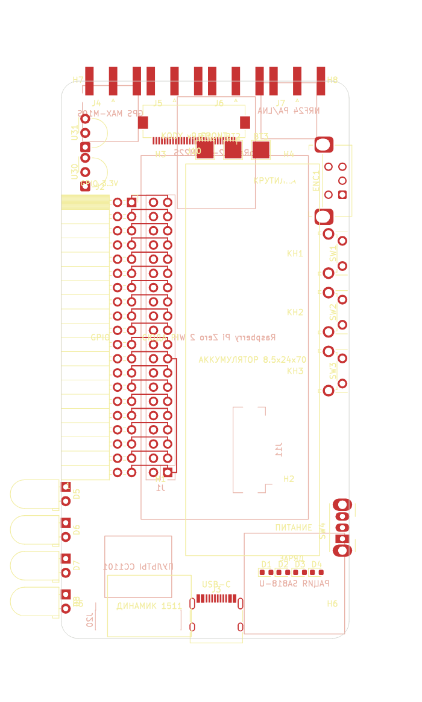
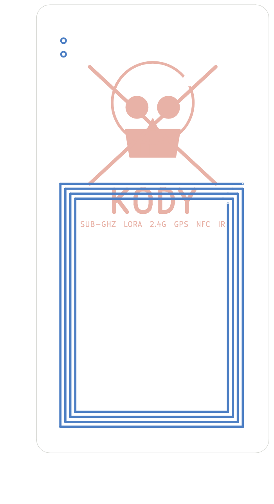

# Платы KODY v9 — этап 1 (механика и разъёмы)

**Наглядно, что где и зачем:** https://claude.ai/artifact/ — страница `docs/pcb/kody-pcb-guide.html` (генерируется `tools/gen_pcb_guide.py`).

Изменения: радиомодули стоят у своих антенн (NRF24, GPS, LoRa — наверху); рация SA818 и CC1101 — внизу, к антенне «Рация 433» короткий кабель с защёлками; ESP32-C5 убран (Wi-Fi/Bluetooth у Pi свои); контуры и подписи всех модулей нарисованы шелкографией на самой плате.

| Передняя | Задняя (вид снаружи) |
|---|---|
|  |  |

Файлы KiCad 7: `front.kicad_pcb`, `back.kicad_pcb` (генерируются `generate_boards.py`).

## Что уже сделано

**Обе платы:** контур 51.6 × 99.6 мм, отверстия под Pi Zero (M2.5) и под корпус
(M2), разъём плата-плата 2×12 1.27 мм (SMD) внизу слева — контакт 1 на обеих
платах в одной точке, цепи подписаны.

**Передняя:**
- J1 — гнездо, сквозь которое проходит гребёнка Pi (раскладка как у Pi, вид сверху);
- J2 — угловое гнездо GPIO на левом краю, **все 40 линий разведены пин в пин**;
- правый край сверху вниз: крутилка EC11/PEC12R (угловая, с кнопкой), 3 кнопки 6×6 угловые, ползунок питания SS12D07/OS102011;
- верхний край: 4 гнезда SMA (LoRa, рация, 2.4 ГГц, GPS);
- нижний край: один USB-C (данные + PD), 4 светодиода индикатора заряда;
- левый край под GPIO: ИК-порт (2× VSLY5940 + 2× TSAL6400), над GPIO — 2 ИК-приёмника;
- разъёмы FPC экрана и HDMI-шлейфа (модель разъёма уточним под купленный экран);
- 3 площадки под лепестки аккумулятора;
- разметкой: места модулей (рация SA818, LoRa, CC1101, NRF24, ESP32-C5, GPS), аккумулятор, динамик, контур Pi.

**Задняя:**
- катушка NFC 13.56 МГц дорожками (4 витка) + площадки к согласованию;
- место и площадки большой намотанной катушки 125 кГц по периметру всей спины;
- pogo-площадки к низу Pi (USB + питание) — **точные места снимем с Pi штангенциркулем**;
- **чёрный череп + KODY** на шелкографии.

DRC KiCad: 0 ошибок меди между цепями. Оставшиеся замечания — края у
разъёмов, которые и должны выходить за край (SMA, USB-C, светодиоды ИК),
и пересечения «рамок» соседних светодиодов (сами корпуса не пересекаются);
несколько контактов разъёма плата-плата ещё не соединены — это сделает схема.

## Как открыть в EasyEDA Pro

1. EasyEDA Pro → **Файл → Импорт → KiCad**.
2. Выбрать `front.kicad_pcb` (потом так же `back.kicad_pcb`).
3. Если попросит проект целиком — запаковать папку `hardware/pcb` в zip.

## Что дальше (этап 2 — схема)

По блокам, каждый проверяется отдельно:
1. Питание: USB-C + CH224K + BQ25895 + DW01A/FS8205A + MAX17048 + TPS61088 + индикатор заряда.
2. Управление: STM32G031 + крутилка + кнопки + ползунок + DRV2605L.
3. Экран: LT6911C + разъём экрана (после проверки экрана на макетке).
4. Радио: RP2350 + SA818 + CC1101 + E22 + NRF24 + ESP32-C5 + GPS + ИК.
5. Задняя: USB2514B + TS3USB221 + TUSB320 + ST25R3916 + 125 кГц.

Перегенерировать: `/usr/bin/python3 hardware/pcb/generate_boards.py --drc`.
